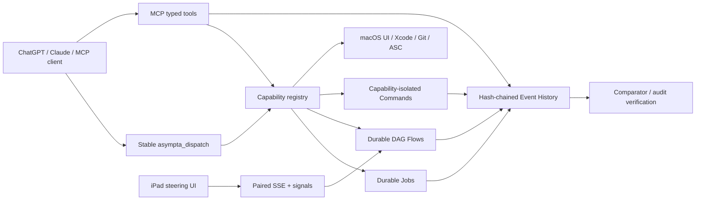

# Asympta Computer — 9.5/10 Target Architecture

Asympta Computer v0.7.0 targets a 9.5/10 quality level as a model-neutral MCP runtime for long-running macOS computer and developer workflows. It is designed around one rule: **reuse procedure, never reuse outcome**.

## Control planes

### 1. Stable dispatch

Custom ChatGPT MCP metadata can be cached by the client. The 9.5 server therefore exposes one intentionally stable tool, `asympta_dispatch`, with three operations:

- `manifest`: server version + schema hash
- `discover`: current server actions and live schemas
- `call`: invoke a discovered action after server-side validation

The dispatch schema is a compatibility boundary and must not receive breaking changes.

This does **not** bypass the ChatGPT platform's metadata refresh requirement. It makes future server capability upgrades functionally reachable after the dispatch tool itself has been refreshed once.

### 2. Durable execution

Long operations are written to durable state before a task handle is returned. Detached workers are independent of the MCP HTTP daemon.

A job stores:

- creation and update timestamps
- worker PID and generation
- heartbeat and lease expiry
- retry/recovery policy
- linked work/step identity
- terminal result or failure

On server startup, orphaned jobs are reconciled. Restart-safe jobs may spawn a new worker after their lease expires. Unknown or side-effectful jobs are not blindly replayed.

### 3. Durable DAG flows

`flow_*` executes a dependency graph rather than a serial todo list.

- dependency-ready nodes can run concurrently
- ready nodes are ordered by estimated critical-path length
- each flow has a configurable parallelism cap
- idempotent nodes can be replayed after worker crash
- a crashed non-idempotent running node becomes `uncertain`
- uncertain nodes require explicit evidence/resolution before resume

This is intentionally conservative around uploads, publishes, commits and other irreversible actions.

### 4. Tamper-evident event history

Every tool action is recorded in the normal audit log and in an append-only event stream. Events contain sequence number, previous hash and SHA-256 content hash.

`event_verify` independently checks:

- sequence continuity
- previous-hash continuity
- content hashes

This is a tamper-evidence mechanism, not a substitute for an external WORM log.

### 5. Capability isolation

The trusted personal-machine `run_command` remains available, but bounded operations should prefer `capability_run`.

Profiles:

| Profile | Boundary |
|---|---|
| `repo_read` | macOS sandbox, no network, no writes, personal Home denied except current repo/config needs |
| `repo_write` | macOS sandbox, no network, writes limited to cwd/temp |
| `apple_build` | strict executable/cwd/minimal-environment capability for Apple toolchain |
| `apple_release` | strict release executable set with native Keychain/network access |
| `network_read` | bounded network client executables |
| `model_client` | MCP model-client process such as Claude Code |

Apple signing/release cannot use the same deny-default sandbox as simple repository reads because Xcode/codesign/Keychain depend on broader system services. Those paths use capability isolation rather than claiming a stronger OS sandbox than macOS can actually support.

### 6. Mac ↔ iPad steering

A LAN steering endpoint runs separately from the loopback MCP endpoint.

- short-lived one-time six-digit pairing code
- signed HttpOnly, SameSite session cookie
- SSE event stream
- persistent steer/pause/resume/cancel signals
- flow workers checkpoint signal sequence numbers

The steering protocol is browser-compatible, so an iPad can steer a Mac without requiring a custom app. A native iPad client can use the same protocol later.

### 7. Model neutrality

Asympta Computer speaks MCP rather than a model-specific protocol. ChatGPT and Claude Code can point to the same HTTP endpoint. Model account authentication remains owned by each provider.

### 8. Reflection and task families

Inspired by the public `openai/math` release structure, Asympta groups similar executions into task-family playbooks, preserves versions/observations, and promotes an invariant only after repeated successful evidence.

A post-task reflection records:

- completion quality
- wall/tool time
- recovered failures
- conservative avoidable work
- invariant/variant candidates
- fastest successful route
- required invalidation checks

Independent comparator-style gates validate outcomes instead of treating model confidence as proof.

## Reliability invariants

1. Durable state is written before returning a task ID.
2. A previous successful outcome is never accepted as current evidence.
3. Non-idempotent uncertain work is never automatically replayed.
4. Final validation is repeated after every consequential workflow.
5. Credentials remain delegated to native Keychain/CLI stores.
6. Plugin/client metadata staleness cannot silently change server-side validation.
7. Audit/event evidence is append-only and independently verifiable.
