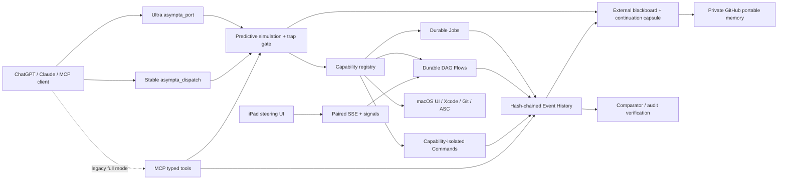

# Asympta Computer — 9.5/10 Target Architecture

Asympta Computer v0.12.0 targets a 9.5/10 quality level as a model-neutral MCP runtime for long-running macOS computer and developer workflows. It is designed around two rules: **reuse procedure, never reuse outcome**; and **simulate before action, replan on deviation**.

## v0.12 Mission / Tasklist wrapper

Long-horizon mission tracking is a projection layer over canonical `work_*`, not a second task database. The wrapper persists only stable mission metadata (focus, completion criteria, horizon, phase). Current progress, ready steps and blockers are derived on read. With a `work_id`, Ultra brief uses this compact mission capsule instead of repeating normal work and continuation state; exceptional trap/replan continuation is included only when needed.

## v0.11 Ultra front plane

The default client surface is intentionally tiny. ChatGPT remains the reasoning brain; Asympta exposes only `asympta_port` plus the stable compatibility `asympta_dispatch`. The complete action catalog stays server-side. `brief` selects only intent-relevant memory/work/routes, `call` stores full results locally and normally returns only a receipt, and Work-style polling by `work_id` can collapse to exactly `{"s":0}` or `{"s":1}`. Full typed exposure remains available with `ASYMPTA_TOOL_EXPOSURE=full`.

This design minimizes **model-visible** tool schemas, context, stdout/diff payloads, and repeated handoff state. It does not claim control over provider-internal token accounting.

## Control planes

### 1. Stable dispatch

Custom ChatGPT MCP metadata can be cached by the client. The 9.5 server therefore exposes one intentionally stable tool, `asympta_dispatch`, with three operations:

- `manifest`: server version + schema hash
- `discover`: current server actions and live schemas
- `call`: invoke a discovered action after server-side validation

The dispatch schema is a compatibility boundary and must not receive breaking changes.

This does **not** bypass the ChatGPT platform's metadata refresh requirement. It makes future server capability upgrades functionally reachable after the dispatch tool itself has been refreshed once.

### 2. Durable execution

Long operations are written to durable state before a task handle is returned. Detached workers are independent of the MCP HTTP daemon.

A job stores:

- creation and update timestamps
- worker PID and generation
- heartbeat and lease expiry
- retry/recovery policy
- linked work/step identity
- terminal result or failure

On server startup, orphaned jobs are reconciled. Restart-safe jobs may spawn a new worker after their lease expires. Unknown or side-effectful jobs are not blindly replayed.

The client request lifetime is intentionally decoupled from the work lifetime. Both normal MCP `tools/call` and stable `asympta_dispatch call` use one durable-execution policy: known long tools are detached automatically, and `run_command` in auto mode promotes when its explicit timeout crosses the configured durable threshold. A client timeout/disconnect therefore does not imply a process timeout.

### 3. Durable DAG flows

`flow_*` executes a dependency graph rather than a serial todo list.

- dependency-ready nodes can run concurrently
- ready nodes are ordered by estimated critical-path length
- each flow has a configurable parallelism cap
- idempotent nodes can be replayed after worker crash
- a crashed non-idempotent running node becomes `uncertain`
- uncertain nodes require explicit evidence/resolution before resume

This is intentionally conservative around uploads, publishes, commits and other irreversible actions.

### 4. Tamper-evident event history

Every tool action is recorded in the normal audit log and in an append-only event stream. Events contain sequence number, previous hash and SHA-256 content hash.

`event_verify` independently checks:

- sequence continuity
- previous-hash continuity
- content hashes

This is a tamper-evidence mechanism, not a substitute for an external WORM log.

### 5. Capability isolation

The trusted personal-machine `run_command` remains available, but bounded operations should prefer `capability_run`.

Profiles:

| Profile | Boundary |
|---|---|
| `repo_read` | macOS sandbox, no network, no writes, personal Home denied except current repo/config needs |
| `repo_write` | macOS sandbox, no network, writes limited to cwd/temp |
| `apple_build` | strict executable/cwd/minimal-environment capability for Apple toolchain |
| `apple_release` | strict release executable set with native Keychain/network access |
| `network_read` | bounded network client executables |
| `model_client` | MCP model-client process such as Claude Code |

Apple signing/release cannot use the same deny-default sandbox as simple repository reads because Xcode/codesign/Keychain depend on broader system services. Those paths use capability isolation rather than claiming a stronger OS sandbox than macOS can actually support.

### 6. Attention-safe background visual control

v0.8 separates **control intent** from the global pointer/focus state.

- `background_window_info` resolves a target window without activating it.
- `screenshot_background_window` captures the target CGWindow directly.
- `background_inspect_ui` reads the target Accessibility tree.
- `background_click_ui_element` invokes AXPress semantically.
- `background_click` maps a target-window coordinate into the AX tree and presses the smallest pressable element under that point.
- `background_set_ui_value` changes settable AX values without keyboard typing.
- `background_draw_vector` renders strokes completely offscreen as SVG with RDP simplification and optional Catmull-Rom smoothing.

The runtime does **not** claim a universal invisible pointer-injection primitive. If an arbitrary game/canvas does not expose an Accessibility/API action, background interaction is unsupported and must not silently fall back to moving the user's mouse or stealing focus.

The live v0.8 harness proved that Safari remained frontmost while a background native app was captured and changed twice (semantic AX press and visual-coordinate AX hit test). The runtime reported `mouse_injected=false`.
### 7. Mac ↔ iPad steering

A LAN steering endpoint runs separately from the loopback MCP endpoint.

- short-lived one-time six-digit pairing code
- signed HttpOnly, SameSite session cookie
- SSE event stream
- persistent steer/pause/resume/cancel signals
- flow workers checkpoint signal sequence numbers

The steering protocol is browser-compatible, so an iPad can steer a Mac without requiring a custom app. A native iPad client can use the same protocol later.

### 8. Model neutrality

Asympta Computer speaks MCP rather than a model-specific protocol. ChatGPT and Claude Code can point to the same HTTP endpoint. Model account authentication remains owned by each provider.

### 9. Reflection and task families

Inspired by the public `openai/math` release structure, Asympta groups similar executions into task-family playbooks, preserves versions/observations, and promotes an invariant only after repeated successful evidence.

A post-task reflection records:

- completion quality
- wall/tool time
- recovered failures
- conservative avoidable work
- invariant/variant candidates
- fastest successful route
- required invalidation checks

Independent comparator-style gates validate outcomes instead of treating model confidence as proof.

### 10. Predictive execution and external blackboard

Before every non-control tool action, the runtime persists a simulated action/result map. The simulation records the intended action, expected status/effect, task-specific variable keys, and three branches: prediction match, deviation, and uncertain disconnect/timeout outcome.

Execution then follows a comparator loop:

1. **simulate** — write the expected action/result map before action;
2. **act** — execute through the normal typed tool/capability/durable-job path;
3. **compare** — classify actual result against the prediction;
4. **match** — continue without replanning;
5. **deviation** — persist a trap and a future re-simulation sequence from actual state;
6. **repeat only after change** — deterministic exact-repeat failures are blocked; transient timeout/network paths get at most one bounded exact retry.

The prediction-match path intentionally avoids an extra hash-chain fsync because the normal `tool.action` audit event is already crash-durable. Measured predictive bookkeeping fell from about **13.916 ms p50** to **5.932 ms p50** after this optimization; post-match bookkeeping is about **0.440 ms p50**.

The external blackboard is append-only JSONL plus a compact continuation capsule. It exists outside the chat context and preserves:

- completed/current/ready work steps;
- active traps and forbidden exact-repeat signatures;
- last prediction outcome/deviation;
- safe resume protocol;
- compact answer/output notes when explicitly checkpointed.

A ChatGPT/browser UI stall cannot be guaranteed detectable or refreshable by the MCP server. Recovery therefore treats UI refresh/re-submit as a client responsibility and makes the server-side invariant stronger: **after reconnect, recover durable state first and never replay a consequential action solely because the chat stalled.**

### 11. Portable GitHub memory

v0.10 separates **long-term learned memory** from **machine-local executable state**.

GitHub (`okok147/asympta-computer-memory`, private) is the authoritative long-term memory source. Each Mac keeps a disposable local clone/cache for latency and offline operation.

Portable categories:

- operator standing instructions/preferences;
- learned playbooks;
- task reflections;
- predictive traps;
- continuation summaries;
- selected blackboard/output notes.

Non-portable categories stay local:

- credentials/tokens/private keys;
- raw audit/event history;
- job/process logs;
- process sessions;
- active worker PIDs/leases;
- transient executable/release state.

Records are append-only and named by logical subject + timestamp + sanitized content hash. This minimizes multi-machine merge conflicts. Import selects the newest logical record while preserving a newer local observation.

Startup schedules a non-blocking GitHub pull/import. Memory-producing lifecycle events queue a debounced sync. Shutdown performs a bounded best-effort flush.

Fresh-machine acceptance proved that an empty state directory can restore the seeded operator profile, playbooks, reflections, traps, continuation capsules and blackboard summaries entirely from GitHub.
## Reliability invariants

1. Durable state is written before returning a task ID.
2. A previous successful outcome is never accepted as current evidence.
3. Non-idempotent uncertain work is never automatically replayed.
4. Final validation is repeated after every consequential workflow.
5. Credentials remain delegated to native Keychain/CLI stores.
6. Plugin/client metadata staleness cannot silently change server-side validation.
7. Audit/event evidence is append-only and independently verifiable.
8. Request timeout is never treated as permission to restart a consequential operation; reconcile durable state first.
9. Background UI control must not silently degrade into focus theft or global mouse injection.
10. Every non-control action must have a pre-action simulation map before execution.
11. A deterministic exact failed signature is never blindly replayed; actual state must change or a different path must be simulated first.
12. Chat/client context loss is recovered from continuation capsules, not by restarting completed side effects.
13. GitHub is authoritative for long-term learned memory; local memory caches are disposable.
14. Executable/transient state is never treated as portable memory and is not restored onto another machine.
